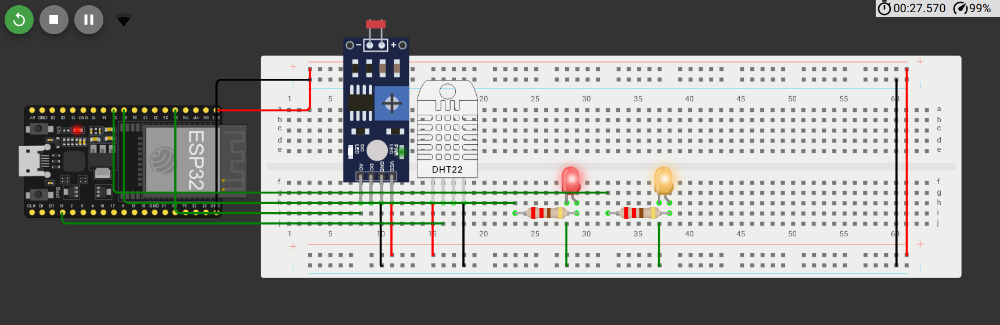
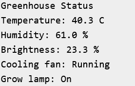
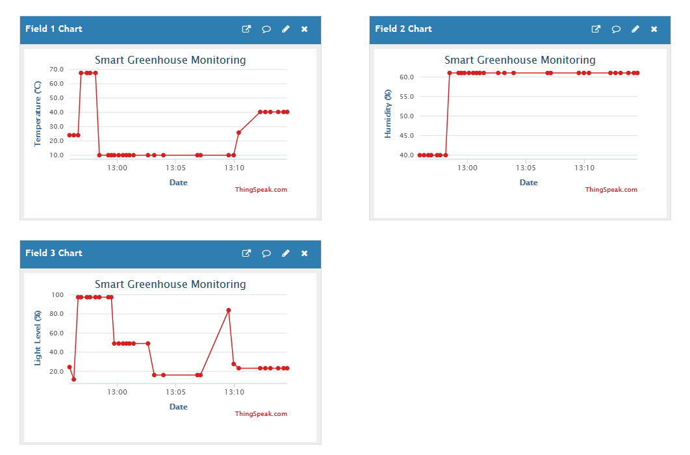

# Smart Greenhouse Monitoring and Climate Control — IoT Project

An ESP32-based IoT project that monitors temperature, humidity, and light intensity to automate greenhouse climate control. The system uses a DHT22 sensor and an LDR photoresistor to collect environmental readings, controls simulated fan and grow-light outputs, and uploads telemetry to ThingSpeak Cloud.

## Project Demonstration

### 1. Wokwi Circuit Simulation

The circuit connects a DHT22 temperature and humidity sensor and an LDR module to the ESP32. Two LEDs represent the cooling fan and grow light, allowing the automatic control logic to be demonstrated in simulation.



### 2. Serial Monitor Output

The Serial Monitor displays the latest temperature, humidity, light level, and actuator states. It also reports network connectivity and the result of cloud uploads.



### 3. ThingSpeak Cloud Dashboard

ThingSpeak receives environmental readings and actuator states from the ESP32. Its channel charts provide a visual representation of changing greenhouse conditions and the system's responses.



## Features

- Temperature and humidity monitoring using DHT22
- Analog light-level monitoring using an LDR module
- Automatic fan control based on temperature thresholds
- Automatic grow-light control based on light-level thresholds
- Hysteresis to reduce unnecessary switching near control thresholds
- Wi-Fi connectivity through the Wokwi virtual network
- Cloud telemetry using the ThingSpeak API
- Serial Monitor output for monitoring and debugging

## Components and Tools

### Simulation Components

- ESP32 DevKit
- DHT22 temperature and humidity sensor
- LDR photoresistor module with analog output
- LED representing the cooling fan
- LED representing the grow light
- Current-limiting resistors for the LEDs

## ThingSpeak Channel Fields

The firmware sends three values to ThingSpeak.

| Field | Data | Description |
|---|---|---|
| Field 1 | Temperature | DHT22 temperature reading in °C |
| Field 2 | Humidity | DHT22 relative humidity in % |
| Field 3 | Light Level | light-level percentage |

The firmware uploads data approximately every 20 seconds. ThingSpeak stores the readings and displays them as time-series graphs.

## How It Works

### 1. Environmental Monitoring

The ESP32 reads temperature and humidity from the DHT22 sensor using the DHTesp library. It reads the LDR's analog output through GPIO 34 using the ESP32's 12-bit ADC.

### 2. Light-Level Calculation

The raw ADC value is converted into a normalized percentage:

```cpp
float lightLevel = 100.0 - (rawLdr * 100.0 / 4095.0);
```

The inversion matches the simulated photoresistor's response in Wokwi, where the analog reading decreases as illumination increases.

This percentage is a normalized indicator for the simulation, not a calibrated lux measurement.

### 3. Automatic Fan Control

The cooling fan is represented by an LED connected to GPIO 26. The firmware uses temperature thresholds with hysteresis:

- Temperature at or above 30°C: fan turns ON.
- Temperature at or below 28°C: fan turns OFF.
- Between 28°C and 30°C: the previous state is maintained.

The gap between the two thresholds prevents rapid switching when the temperature fluctuates around a single threshold.

### 4. Automatic Grow-Light Control

The grow light is represented by an LED connected to GPIO 27.

- Light level below 35%: grow light turns ON.
- Light level above 45%: grow light turns OFF.
- Between 35% and 45%: the previous state is maintained.

This hysteresis provides stable switching around the configured light-level thresholds.

### 5. Cloud Telemetry

The ESP32 connects to the Wokwi virtual Wi-Fi network and sends HTTP requests to the ThingSpeak update API.

Each upload contains the temperature, humidity and the light-level percentage. The Serial Monitor reports whether the upload succeeded.

The firmware also attempts to reconnect to Wi-Fi if the connection is lost.

## Testing and Limitations

The project is designed to demonstrate sensor monitoring, threshold-based climate control, and cloud reporting in a simulated environment.

- Temperature, humidity, and illumination values depend on the simulated sensor settings.
- The light-level percentage is normalized and is not a calibrated lux measurement.
- The fan and grow light are represented by LEDs; actual motors and lamps have not been tested.
- The control thresholds are demonstration values and may require adjustment for a real greenhouse.
- Cloud uploads require a working network connection and a valid ThingSpeak Write API Key.

## Future Improvements

- Calibrate light measurements and report estimated lux values.
- Add additional environmental sensors for soil moisture and water level.
- Introduce configurable temperature and illumination thresholds.
- Add alerts for excessive temperatures or prolonged low-light conditions.
- Improve sensor filtering and fault handling.
- Integrate physical actuators through appropriate driver circuits.
- Add historical analysis and more detailed ThingSpeak visualizations.

## Conclusion

This project demonstrates how an ESP32 can combine environmental sensing, automatic actuator control, and cloud-based monitoring in a single IoT application. Using Wokwi and ThingSpeak makes the system accessible for online development and demonstration without requiring physical electronics.

## Project Team

| Roll Number | Name |
|:-----------:|:----:|
| 13030824006 | ADARSH BHARTI |
| 13030824007 | ADIL RAZA |
| 13030824008 | SHABNOOR KHAN |
| 13030824009 | RAVI RAJ |
| 13030824010 | SANYA SAMPRATI |

**Department:** Computer Science & Engineering (Artificial Intelligence & Machine Learning)